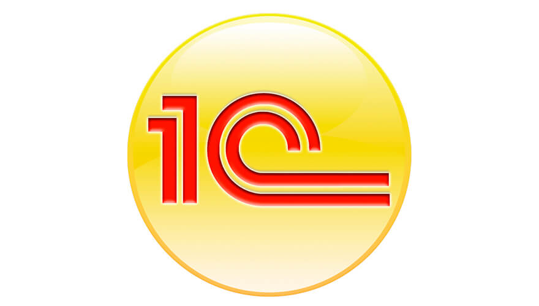

<div align="center">



# 1С · Exam Trainer

**Веб-тренажёр для подготовки к экзаменам 1С:Профессионал**

Практика • Обучение по разделам • Разборы ответов • Свой банк вопросов

<p>
  
  
  
</p>

<p>
  
  
  
  
</p>

[Возможности](#-возможности) · [Запуск](#-быстрый-старт) · [Пояснения](#-пояснения-к-ответам) · [Структура](#-структура-проекта)

</div>

---

## ✨ О проекте

**1С · Exam Trainer** — неофициальное учебное Flask-приложение, в котором можно подготовиться к сертификации, пройти пробный экзамен, разобрать ошибки и повторить материал по тематическим разделам.

Интерфейс выполнен в стиле **тёмного металла с мягкими золотистыми акцентами**. Банк вопросов хранится локально в SQLite и доступен без внешнего сервиса при работе самого тренажёра.

### Два направления подготовки

| 📘 Платформа 1С:Предприятие 8.3 | 🏢 1С:ERP Управление предприятием 2.5 |
|:---|:---|
| **960** вопросов в исходных файлах | **761** вопрос в исходных файлах |
| 14 тематических разделов | 14 тематических разделов |
| Конфигуратор, язык, формы, запросы, регистры и другие механизмы платформы | НСИ, закупки, склад, продажи, казначейство, производство, учёт и другие темы |

> **1 721 вопрос** — количество в исходных текстовых файлах проекта на 24.11.2026. Фактическое содержимое локальных баз `.db` может отличаться после редактирования через личный кабинет.

## 🚀 Возможности

| Режим | Что доступно |
|:---|:---|
| 🎯 **Экзамен** | Пробное тестирование: 14 вопросов, допускается не более двух ошибок |
| ✅ **Экзамен с ответами** | Практика с правильными ответами и доступом к пояснениям |
| 📚 **Учить по разделам** | Последовательное изучение вопросов внутри тематических категорий |
| 💡 **Почему этот ответ?** | Всплывающее окно с разбором текущего вопроса |
| 🧾 **Результаты и ошибки** | Итог экзамена и просмотр допущенных ошибок |
| 🛠️ **Кабинет администратора** | Добавление, изменение, просмотр, удаление вопросов, навигация по категориям и постраничный вывод |

### Интерфейс

- Удобная главная страница с выбором экзамена и режима.
- Кнопки с плавным наведением, скруглениями и золотистым свечением.
- Карточки вопросов, категории и адаптация элементов под разную ширину экрана.
- Отдельный режим администратора для работы с обоими банками вопросов.

## 🏁 Быстрый старт

**Необходимое:** Python 3.10 или новее, Git и доступный порт **8080**. Приложение запускается из корня репозитория.

### 1. Получить проект

```bash
git clone https://github.com/Denis-create-boop/test1c.git
cd test1c
```

### 2. Установить Flask

Для локальной веб-версии достаточно Flask: остальные основные используемые модули Python, включая `sqlite3` и `webbrowser`, входят в стандартную библиотеку.

```bash
python -m pip install Flask
```

*При необходимости создайте виртуальное окружение перед установкой зависимостей.*

### 3. Запустить приложение

```bash
python main.py
```

Откройте **http://localhost:8080**. При запуске приложение пытается открыть эту страницу в браузере автоматически. В GitHub Codespaces используйте перенаправление порта **8080** и откройте ссылку из вкладки **Ports**.

Приложение имеет страницу авторизации; данные учётных записей в README намеренно не публикуются.

<details>
<summary><b>Обновление проекта в Codespaces</b></summary>

Из корня репозитория выполните:

```bash
git pull origin main
```

Перезапустите `python main.py` и обновите страницу браузера. Перед переносом или обновлением обязательно сохраните копию локальных файлов `.db`, если редактировали вопросы или пользователей.

</details>

## 💡 Пояснения к ответам

Кнопка **«Почему этот ответ правильный?»** появляется в режимах обучения и экзамена с ответами. **В обычном экзамене её нет**.

Для прозрачности материалы делятся на два уровня:

| Тип разбора | Что означает | Количество в исходной поставке |
|:---|:---|---:|
| 📗 **Авторское пояснение с источником** | Подготовлен отдельный содержательный текст со ссылкой на материалы по теме. Это не дословная копия ИТС и не автоматическая гарантия актуальности ответа. | **44** |
| 📝 **Предварительный разбор** | Создаётся из существующих вариантов и ключа правильного ответа. Помогает ориентироваться в вопросе, **но не доказывает правильность ключа**. В интерфейсе специально выделен предупреждением. | **1 677** |

**Итого:** при первом обращении к пояснениям SQLite создаёт материалы для всех **1 721** вопросов из исходных файлов. Новые вопросы, добавленные через кабинет, тоже могут получить предварительный разбор.

- Основные тексты: [`databases/explanation_seeds.json`](databases/explanation_seeds.json).
- Хранение и создание записей: [`databases/explanations.py`](databases/explanations.py).
- Локальная база пояснений: `explanations.db` (создаётся автоматически).

> ⚠️ **Важно:** предварительные разборы не являются официальными объяснениями 1С:ИТС. Перед реальным экзаменом проверяйте спорные формулировки и ответы по актуальной документации и действующему изданию экзаменационного пособия.

## 🧱 Структура проекта

```text
test1c/
├── main.py                       # Точки входа, тестирование и обучение
├── admin.py                      # Авторизация и кабинет вопросов
├── templates/                    # Jinja2-страницы
├── static/
│   ├── style.css                 # Общие стили интерфейса
│   └── images/                   # Изображения и фон
├── questions/
│   ├── prof/                     # 14 файлов с вопросами по платформе
│   └── erp/                      # 14 файлов с вопросами по ERP
├── databases/
│   ├── questions_prof.py         # Работа с банком по платформе
│   ├── questions_erp.py          # Работа с банком ERP
│   ├── explanations.py           # Пояснения и SQLite
│   └── explanation_seeds.json    # Отдельные авторские пояснения
├── tools/
│   ├── audit_questions.py        # Проверка структуры вопросов
│   └── audit_explanations.py     # Оценка покрытия пояснениями
├── *.db                          # Локальные SQLite-данные
└── README.md
```

### Проверка банка вопросов

Инструменты не меняют вопросы и ответы:

```bash
python tools/audit_questions.py
python tools/audit_explanations.py
```

Подробности по обнаруженным расхождениям и текущей редакции экзаменов — в [отчёте аудита](AUDIT_EXAMS_2026.md).

## 🔐 Данные и ограничения

- **SQLite** подходит для этой локальной учебной сборки. Вопросы, пользователи и пояснения хранятся в отдельных файлах базы данных.
- Изменения локальных `.db` **не передаются автоматически в GitHub**. Делайте резервные копии после редактирования вопросов.
- Авторизация в текущей версии использует **общее состояние в `params.db`**, а не независимые сессии пользователей. **Не публикуйте приложение в открытый интернет без усиления авторизации и проверки безопасности.**
- Экзаменационные материалы могут меняться. Особенно важно учитывать обновление комплекта **1С:ERP 2.5 в 2026 году**. Сверка всех исходных вопросов с официальным актуальным комплектом не завершена.
- Проект **не является официальным продуктом фирмы «1С»** и не заменяет официальную сертификацию.

---

<div align="center">

### Учись · Проверяй себя · Разбирай ошибки

**Сделано для практической подготовки к экзаменам 1С.**

[⬆ Вернуться к началу](#1с--exam-trainer)

</div>
